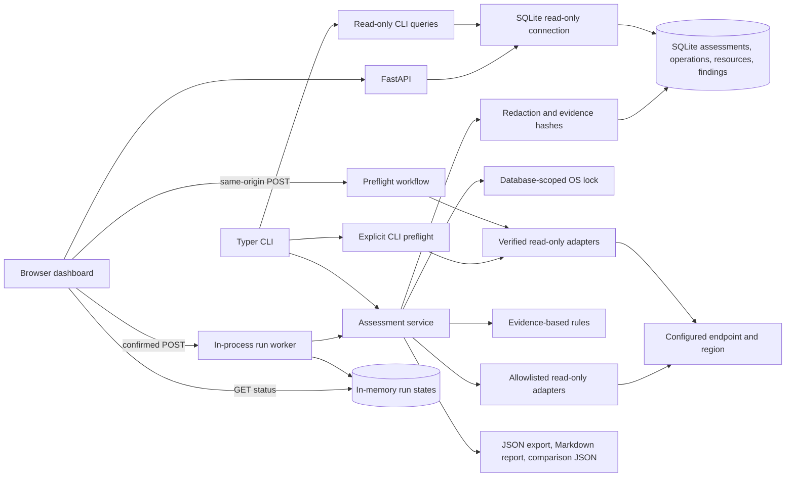

# AEGIS Architecture and Phase 1 Reconnaissance

## Scope and claims

AEGIS is a local-first assessment tool for the configured Floci endpoint. Its results must distinguish API observations, inferred risks, simulated cases, unsupported operations, and errors. The initial implementation is read-only. Nothing in this document asserts complete AWS compatibility, production readiness, or autonomous detection.

## Existing lab assessment

### Repository and files inspected

- Public repository: `c3m2r4/Open-Cybersecurity-Operating-Model`, cloned read-only at commit `ad9513cf8b1879808e9b30960e168b309da7cf24` for reconnaissance. The Floci project was located under `11 - SECURITY PROJECTS/Floci AWS Local Cloud Lab/`.
- Reconnaissance reviewed the lab bootstrap script and its setup, architecture, service, and discovery notes.
- AEGIS capability claims are based on observed API responses; lab scripts and configuration notes are not treated as proof of API support.

### Existing bootstrap behavior

The lab uses a local Floci-compatible endpoint with test-only identity values. Its bootstrap script can provision and configure cloud resources; its intended service list is not evidence that corresponding API operations are supported.

The bootstrapper is an infrastructure tool, not a safe assessment harness. It can create, update, or delete resources. AEGIS will not invoke it; assessment adapters use only independently verified read operations.

The script suppresses many errors using `|| true` or redirects, so the script's intended service list is not proof of service support. Its README's claim of 20+ provisioned resources is also not a measured capability guarantee.

### Environment observed during reconnaissance

- Floci API responded at `http://127.0.0.1:4566`; S3 root returned HTTP 200 and XML.
- `sts get-caller-identity` succeeded with account `000000000000` when the documented local test credentials were supplied.
- Read-only calls succeeded for `ec2 describe-instances`, `iam list-policies --scope Local`, `logs describe-log-groups`, and `s3api list-buckets`.
- CloudWatch Logs returned `storedBytes`; regression tests cover omitted, zero, and nonzero values.
- AWS CLI initially failed when no credentials were present; after selecting the configured local Floci profile, STS and the read-only calls above worked. Local emulator credentials are not reproduced in this documentation.
- No live API calls that change resources were made. No existing resource was deleted or modified.

## Confirmed and unverified capabilities

| Service / capability | Status from this reconnaissance | Evidence / limitation |
|---|---|---|
| STS identity | Supported and observed | `GetCallerIdentity` returned an identity response. |
| S3 bucket inventory | Supported and observed | `ListBuckets` returned bucket records. Bucket policy/public-access configuration still needs separate operation probes. |
| EC2 instance inventory | Supported and observed | `DescribeInstances` returned instances. `DescribeSecurityGroups` was independently verified and returned ingress CIDRs and port ranges; VPC/subnet data and pagination remain separately unverified. |
| IAM local policy listing and document | Supported and observed | `ListPolicies --scope Local` returned policies. `GetPolicyVersion` for an observed default version returned a policy document. Attached entities, roles, trust policy, and effective permission analysis remain unverified. |
| CloudWatch Logs group inventory | Supported and observed | `DescribeLogGroups` returned groups and `storedBytes`. `retentionInDays` was omitted in live observations, so retention checks are `NOT_SUPPORTED` for those groups. Resource policy, pagination and stream operations remain unverified. |
| CloudTrail, Lambda, DynamoDB, SQS, EventBridge, RDS, EKS, KMS, Secrets Manager, SSM, API Gateway, ELB, Step Functions, CloudFormation, SES | Intended/configured by lab notes, operation-level status unverified here | Bootstrap section or phase note is not sufficient proof. Must probe read-only operation and record success/failure per operation. |
| Pagination and throttling | Unverified | Implement only with operation-specific validated tokens; do not assume AWS semantics. |
| Compatibility with real AWS | Unverified and out of initial scope | Floci compatibility must not be presented as AWS parity. |

## Implemented runtime architecture

The current implementation uses Python 3.11+, a Typer CLI, boto3/botocore, a direct `sqlite3` persistence layer, and validated settings from the process environment. CLI commands call the assessment service; discovery uses only the explicitly allowlisted read operations. The service sanitizes operation evidence before persistence, evaluates rules over normalized inventory, and builds JSON or Markdown output from stored records. `doctor` separately checks local configuration, SQLite, endpoint TCP reachability, credentials, and STS identity. The optional FastAPI dashboard reads saved records through a separate SQLite `mode=ro` query layer. Its explicit preflight and confirmed assessment POST actions reuse the same workflow/adapters and service; ordinary GET routes never call cloud APIs.



### Initial data model

- `Assessment`: UUID, start/end UTC timestamps, endpoint identifier (without credentials), region, tool version and overall status.
- `Operation`: assessment ID, service/operation, capability state, success/unsupported/error status, optional subject resource ID, observed time, sanitized response, and SHA-256 hash.
- `Resource`: assessment ID, canonical type and ID, display name, observed time, source service/operation, and sanitized normalized attributes. Supporting raw evidence hashes live on operation records.
- `Finding`: assessment ID, rule ID, resource ID, outcome, severity, reason, evidence references, remediation text, evaluation timestamp, and prior-outcome comparison.
- Evidence is stored as a sanitized operation response with collection time and SHA-256 digest. Hashes detect accidental changes; local storage is not tamper-proof against a host administrator.

### Adapter contract

Each adapter declares service and operation metadata, required permissions/inputs, whether pagination is verified, a read-only collection function, a normalizer, and error mapping. It returns observations plus operation-level errors and unsupported outcomes. An empty successful list is an observed empty result, never a fabricated resource. A failed operation produces a partial inventory, not an empty-success claim.

## Proposed directory structure

```text
aegis/
  pyproject.toml
  README.md
  .env.example
  src/aegis/
    __init__.py
    cli.py
    config.py
    logging.py
    db.py
    models.py
    orchestrator.py
    adapters/
      base.py
      sts.py
      s3.py
      ec2.py
      iam.py
      cloudwatch_logs.py
    inventory/
      normalize.py
      query.py
    rules.py
    evidence/
      redact.py
      store.py
    policy/
    risk/
    reporting/
    web/
  tests/
    unit/
    integration/
  docs/
```

## MVP milestone

Implement and validate a strictly read-only CLI foundation with:

1. `aegis doctor`: configuration, Python/dependency, SQLite, endpoint and STS status with clear per-check outcomes.
2. `aegis discover`: the independently verified read operations for STS, S3, EC2 instances/security groups, IAM local policies/default policy versions, and CloudWatch Logs groups, recorded independently; support partial inventory and sanitized JSON output.
3. SQLite persistence for assessment runs, capability status, normalized resources, and redacted evidence with hashes.
4. `aegis export --format json` for a selected or latest assessment.
5. Mocked unit tests for normalization, empty lists, partial failures, redaction, and CloudWatch `storedBytes` (missing/zero/nonzero); integration tests against Floci remain opt-in.

Phase 3 adds a read-only rules engine for observed wildcard IAM policy grants, public SSH/RDP security-group ingress, and explicit CloudWatch retention values against a local 30-day baseline. `GetPolicyVersion` and `DescribeSecurityGroups` were independently verified against Floci before they were added. Missing evidence returns `NOT_SUPPORTED`; malformed evidence returns `ERROR`. Findings are persisted with source-operation references and cross-assessment comparison state. S3 bucket configuration checks remain unsupported because the observed bucket listing contains names only. No remediation, simulations, dashboard, or service mutations are part of this milestone.

Phase 4 adds stored-assessment comparison and reporting without changing cloud adapters or the database schema. Comparison identity is `(rule_id, resource_type, resource_id)`; records missing any identity component are uncomparable. If a failed finding has no current evaluation, it is `not_reassessed`, not resolved. Resolution requires a later `PASS` or `NOT_APPLICABLE` with references to successful persisted operations and response hashes. `NOT_SUPPORTED`, `ERROR`, and missing or unsuccessful evidence are never treated as success. A new finding is a failing identity absent from the earlier assessment; a known transition from `PASS` to `FAIL` is classified as changed. Inventory additions/removals and observed name/attribute changes use normalized `(resource_type, resource_id)` identity. `aegis report` reads persisted data only, emits JSON schema version `1.0` or Markdown, and includes operation coverage and limitations.

Phase 6 added the optional, loopback-bound dashboard and read-only API. All ordinary GET requests use the separate no-create/no-migrate SQLite query layer and do not trigger cloud work. Phase 7 adds a local-only preview, explicit preflight discovery, and confirmed scan launch. Preflight does not persist cloud responses; it checks database write availability with a rolled-back SQLite transaction or a short-lived file probe. The scan worker runs in-process and records status in memory while the assessment service persists the actual terminal assessment. No cancellation or progress percentage is claimed. A mode-0600 sidecar OS lock serializes CLI and dashboard preflight/discovery/assessment across processes; the empty lock file remains after release. A browser disconnect does not terminate server-side work.

## Phased plan

1. **Reconnaissance and architecture:** complete this document, verify environment, distinguish script intent from API evidence.
2. **Foundation:** settings, structured logging, adapter interface, SQLite schema, CLI doctor/discover/export, redaction.
3. **Assessment engine:** verified inventory adapters, declarative rules, explicit PASS/FAIL/NOT_APPLICABLE/NOT_SUPPORTED/ERROR outcomes and evidence references.
4. **Risk and graph analysis:** transparent configurable scoring, explicit evidence-backed relationships, inferred edges labeled separately.
5. **Safe validation:** synthetic/offline scenarios first. Any live lab change requires explicit target allowlist, before-state capture, proposed diff and user authorization at invocation. Implement reversible remediation only after a verified operation exists.
6. **Reporting and local UI:** actual stored results only, JSON/Markdown/CSV first, then a localhost dashboard.
7. **Quality and demonstration:** unit tests, opt-in Floci integration tests, security review, reproducible demo against explicitly designated resources.

## Technical risks, prioritized

1. **Local lab mutation or data loss:** existing bootstrap has EC2 termination/recreation and resource creation behavior. Keep AEGIS assessment adapters read-only and do not call bootstrap.
2. **False claims from AWS-like APIs:** an AWS CLI operation can be absent or incomplete in Floci. Track capability per operation; successful sibling calls do not establish service-wide support.
3. **Sensitive evidence leakage:** redact credentials, authorization headers, tokens, secret values, secret parameters, and user data before persistence/export; minimize raw payload storage.
4. **Partial failures and misleading empty inventory:** preserve operation failures, timeouts, and incomplete pagination in assessment status.
5. **Local endpoint exposure:** Keep local assessment endpoints bound to trusted interfaces and avoid credential collection in logs.
6. **Evidence integrity overstatement:** local hashes are useful for integrity checks but do not protect evidence from privileged local modification.
7. **Time-varying lab state:** observed resources and `storedBytes` are point-in-time snapshots. Re-probe before writing integration expectations.

## Configuration and safety defaults

- Endpoint defaults to `http://127.0.0.1:4566`; require explicit config to use another endpoint.
- Region defaults to `us-east-1` but remains configurable.
- CLI and web entry points load settings from exported process variables and an optional `.env` file; exported variables take precedence. AWS credentials use boto3's standard provider chain (including profiles). `.env.example` contains no credentials. Local emulator credentials must never be reused with real AWS.
- `doctor` checks both TCP reachability and credential-backed STS identity, and reports `NOT READY` if identity verification fails. A reachable endpoint alone is not service readiness.
- Read-only mode is the only supported mode in the MVP.
- Never persist AWS credentials or include them in evidence.
- Use explicit bounded connect/read timeouts and disable automatic retries so a failed assessment does not silently repeat cloud calls.
- Assessments are `COMPLETED` when all operations and applicable rule evaluations have sufficient evidence, `PARTIAL` when some operations fail/are unsupported or a rule returns `NOT_SUPPORTED`/`ERROR`, and `FAILED` when discovery has no successful operation. Empty inventory and operation errors do not create synthetic scope findings; reports prominently state when no resource-level conclusions are available.
- The web server binds `127.0.0.1` and validates Host and same-origin POSTs. There is no authentication; loopback binding does not protect against every local threat.
